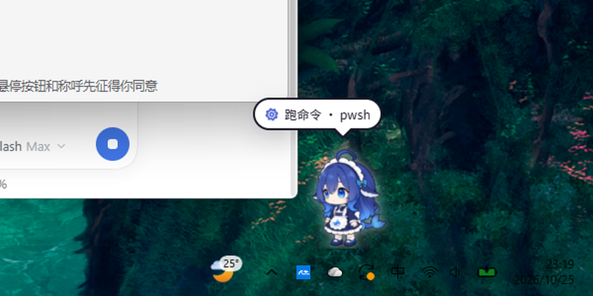
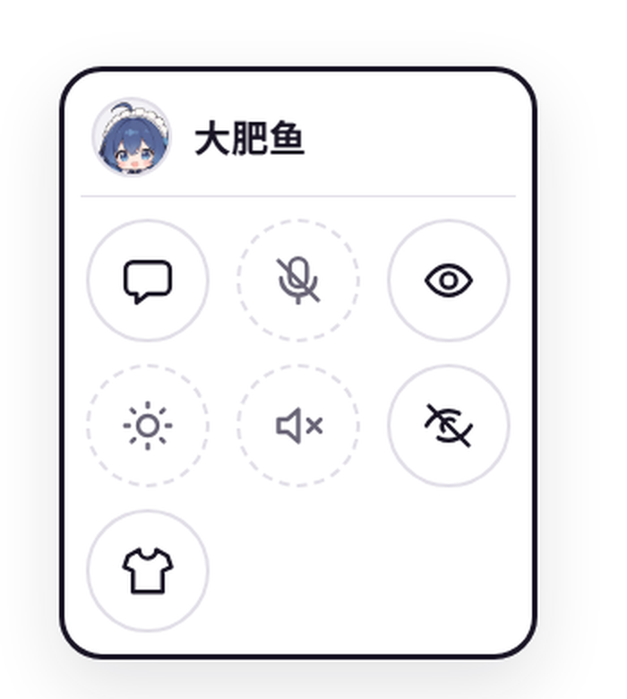
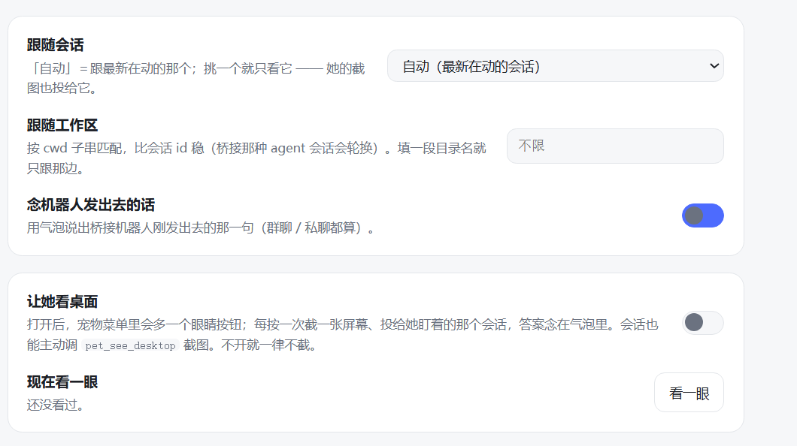

# dsh-cortico-pet

把 [Cortico](https://github.com/Pal-AI-Lab/Cortico) 的桌宠搬进 **DeepSeek Harness**：一只 Q 版「大肥鱼」（DeepSeek 女仆鲸）。
她能**住在桌面上**（真·透明置顶窗口，盖住整个桌面、平时鼠标穿透），也能只在 Harness 窗口里浮着——
想你的时候溜达两步，你干活的时候跟着想、跟着跑工具、收工时点点头，闲久了会打盹。

> **⚠️ 非官方移植**：这是社区作品，不是官方插件，与上游作者、DeepSeek 官方都没有隶属、授权或背书关系。

- **上游**是 `cortico-world-desktop-pet`（[Pal-AI-Lab/Cortico](https://github.com/Pal-AI-Lab/Cortico)，MIT）。
  Coopanion 里内置的那只桌宠就是它；本仓库把「宠物本身」搬进 Harness，换掉了宿主，别的没变。
- **遇到问题请提到本仓库的 Issues**，不要去打扰上游维护者。
- **形象**（鲸鱼娘）是**同人二创**，署名与再分发注意事项见 [NOTICE.md](NOTICE.md)。
- **许可**：本移植部分 MIT，见 [LICENSE](LICENSE)；上游许可见
  [LICENSE.cortico-world-desktop-pet](LICENSE.cortico-world-desktop-pet)。



<p align="center">
  
  &nbsp;&nbsp;&nbsp;
  
</p>

## 特性

- **两种住法**：真·桌面透明置顶窗口（鼠标穿透），或 Harness 窗口里的穿透浮层；两种加载的是同一张宠物页
- **跟着 Harness 的事件动**：一轮开始冒「在想…」、跑工具时报「读文件 · read」「跑命令 · pwsh」、说完话念第一句、
  出错晕一下、收工点头、5 分钟没动静自己坐下打盹
- **鼠标只在她身上吃事件**，其余地方完全穿透，不影响你点按钮、拖选区
- 点她会吓一跳 / 被戳 / 被拎起来扔；右键或长按出菜单（聊天 / 走动 / 配色 / 音效 / 装扮）
- **抱在怀里聊天**：点「聊天」打字回车 → 直接当成 prompt 发进你当前这个会话
- **8 套配色 × 3 套服装**（Harness / DeepSeek / ChatGPT / Claude / Gemini / Qwen / Kimi / MiniMax × 女仆 / 冬装 / 店员）
- **跟随会话 / 跟随工作区**：跟最新在动的会话，或钉死某一个（会话 id 会轮换的场景按 cwd 钉）
- **念机器人发出去的话**：桥接机器人调用发送工具时，她在气泡里说出刚发出去的那一句
- **她的眼睛**（可选、默认关）：点一下截屏投给她盯着的会话，或由会话自己调 `pet_see_desktop` 拿截图
- 全部偏好落在 profile 里的一份 JSON，改完立即生效，不需要重启

## 安装与使用

**要求**：Windows + DeepSeek Harness（桌面端）；Node 22+ 只在你手动跑 `dev/` 自检时才需要。

```powershell
# 1) 把仓库放到本机任意位置，然后在 Harness 里「插件 → 安装」填 link: 加绝对路径
#    插件 → 安装 → link:<这个仓库的绝对路径>

# 2) 或者命令行（profile 目录按你的 Harness 版本可能是 profiles/web 等）
cd ~/.dsh/profiles/desktop
pnpm add link:<这个仓库的绝对路径>

# 3) 重启一次 DeepSeek Harness
```

重启后插件列表里应出现 `dsh-cortico-pet`（active），桌面上就会出现她。第一次用：

1. **设置 → 桌宠**：确认「显示桌宠」是开的；「她住在哪儿」默认 `自动`（桌面窗口起得来就用桌面）。
2. 想换皮肤：配色 / 服装 / 大小 / 光晕都在同一页。
3. 想让她能看屏幕：打开「让她看桌面」——细节见下面「她的眼睛」，默认是关的。
4. 桌面窗口起不来的话，独立设置页里能看到原因（「桌面窗口状态」），旁边可以「重启桌面窗口」。

> 装完**必须重启一次 Harness**：Host 半边是新代码，Node 的模块缓存不会热更。
> 之后再改配置不用重启；只改 `web/` 下的前端文件，刷新页面即可。

## 两种住法

| `surface` | 她住在哪 | 说明 |
|---|---|---|
| `desktop` | **真桌面窗口** | 一个自己拉起的 Electron 进程：透明、无边框、`alwaysOnTop(screen-saver)`、`skipTaskbar`、盖住主显示器工作区；`setIgnoreMouseEvents(true,{forward:true})` 让鼠标默认穿透，只有她身上、气泡、菜单和悬停按钮吃事件 |
| `page` | Harness 窗口内的浮层 | 注入到页面里的全屏穿透 iframe，跟着 Harness 窗口走 |
| `both` | 两处都有 | 同一份宠物页开两份，指令广播给两边 |
| `auto`（默认） | 桌面优先 | 桌面窗口起得来就用桌面，起不来（没有 Electron）自动退回页面内 |

桌面窗口用的 Electron **不需要联网下载**：先看设置里的 `electronPath` / `DSH_CORTICO_PET_ELECTRON`，
再看本插件之前解压过的 `%LOCALAPPDATA%\dsh-cortico-pet\electron\<版本>\`，最后从本机共用的
`%LOCALAPPDATA%\electron\Cache\electron-v*-win32-x64.zip`（别的 Electron 插件留下的缓存）解压一份。

> 踩过的坑：Harness 桌面端给子进程导出了 `ELECTRON_RUN_AS_NODE=1`，谁继承它谁就跑成纯 Node。
> `lib/desktop-window.js` 在 spawn 前把它（连同 `NODE_OPTIONS`）删掉。

## 设置

「设置 → 桌宠」：

| 项 | 说明 |
|---|---|
| 显示桌宠 | 总开关（侧边栏底部也有一个眼睛按钮） |
| 她住在哪儿 | `自动` / `桌面窗口` / `页面内` / `都显示` —— 见上面「两种住法」 |
| 形象 | 只有 `whale`（那只鲸鱼娘，WebGL）。Coo 已移除 |
| 配色 / 服装 | 形象包的 `scheme` / `outfit`，即换皮肤 |
| 大小 / 光晕 | 0.6–1.8 倍；背后那圈柔光 0–20 |
| 走动 | `off` 站着、`calm` 偶尔溜达、`free` 想走就走 |
| 音效 | 脚步、被碰的小动静 |
| 状态气泡 | 她头顶那行「在想… · read」 |
| 回答说一遍 | 每轮结束把答案第一句念出来（长答案只取第一句 + 截断） |
| 抱在怀里聊天 | 允许从她的输入框往当前会话发 prompt |
| 跟随会话 | **下拉选**：「自动」＝跟最新在动的那个，或直接挑一个具体会话（截图也投给它） |
| 跟随工作区 | 按会话 `cwd` 子串匹配（机器人 / 桥接那种会轮换会话 id 的场景用它更稳） |
| 念机器人发出去的话 | 桥接机器人调用发送工具时，用气泡说出它刚发出去的那一句（从工具参数里取） |
| 让她看桌面 | 打开后菜单里多一个眼睛按钮，会话里也多一个 `pet_see_desktop` 工具，见下面「她的眼睛」 |
| 现在看一眼 | 不用去找按钮，直接在这里让她看一眼，结果显示在下面 |
| 调试宿主事件 | 把 Host 事件原文写日志，用来对字段 |

独立设置页里还有「桌面窗口状态」和「重启桌面窗口」——因为窗口起不来时最需要看到原因。

「设置 → 桌宠」里，第一张卡片底部会直接写她现在在哪（`桌面窗口运行中 · pid …` / `已收起` /
`桌面窗口没起来：<原因>`）；写偏好的请求失败时，面板顶部会把原因写出来，不再静默失败。

## 她的眼睛

她本来什么都看不见，只收到 Harness 的事件。「让她看桌面」打开之后，有三条路让她看一眼：

1. **菜单里的眼睛按钮**（也可以点设置里的「看一眼」，或 `POST /dsh-cortico-pet/api/look`）：截一张当前
   整个虚拟屏幕、缩到 1280 宽、存进 Harness 附件库，然后把**这张图投给她盯着的那个会话** —— 作为一条
   user 消息（文字 + 图片）走 `sessionController.prompt`，那个会话的 agent 看图后回答，她再把答案第一句
   念在气泡里。没有可用会话时退回直连默认模型，说一句自己看到的。
2. **会话自己主动看**：同一个开关打开后，会话里会多出工具 `pet_see_desktop`（`reason` 可选），调它就能
   拿到一张当时的桌面截图，图片直接进工具结果（`output.render` 返回 `text + image` 两个块）。
3. 两条路用的是同一段截图代码（`lib/sight.js` 的 `shoot()`），尺寸、编码、落库方式一致。

边界是刻意收窄的，因为截图是真的隐私：

- **默认关**。关着的时候按钮不存在、工具会直接拒绝（回一句「先问用户要不要打开」），也不会截图。
- **没有定时、没有后台**：只有一次点击或一次工具调用对应一次截图，4 秒内不重复截。
- 工具是全局注册的（工具表没有按会话分区的能力），但它自己会判断：开关关着就拒绝；选了具体会话时，
  只有那个会话能调，别的会话调会被告知「桌宠现在只跟着另一个会话」。
- 截图落在系统临时目录，读完就删；留在磁盘上的只有附件库里那份**归一化后的图**（内容寻址，
  和你在对话里贴图走的是同一套）。
- 模型不吃图（`inputModalities` 里没有 `image`）时她只会说一句「`<model>` 不吃图」，不会硬发。
- **第三方 agent 预设常自带工具白名单**。有些 IM / 群聊桥接插件会在自己的 preset 里用 `tools.guard`
  只放行那个桥接的 MCP 工具；那样的会话里 `pet_see_desktop` 会被对方拦下，报错原话通常是
  「工具 `pet_see_desktop` 不在 … 白名单内」。要让它可用，得去那份守卫里放行本工具，并给那个人设补一句例外
  （否则它会照「你没有本地工具」自行拒绝）。守卫和人设都是启动时装载的，改完要重启。
  代价说明白：这等于把「截你屏幕」的能力交给那个会话的对话者 —— 只在你打开「让她看桌面」时有效，
  关掉就全停。
- 截图后端两个：先找带 Pillow 的 Python（`DSH_PET_PYTHON`、`~/.dsh/dsh-runtimes/*/dependencies/python/python.exe`、
  再退到 `PATH` 上的 `python`），失败就换 Windows PowerShell + `System.Drawing`（顺带调了 DPI 感知）。
  两个都用文件收输出，不用管道 —— 受限进程打不开命名管道。
- 调她眼睛的时候不用重启 DSH：`POST http://127.0.0.1:19387/dsh-cortico-pet/reload-sight` 会带新的
  `?rev=` 重新 import 一遍 `lib/sight.js` 并换掉实例（Host 的模块缓存对 `index.js` 本身仍然生效）。

偏好落在 `<profile>/dsh-cortico-pet.json`（Host 里有 `DSH_PROFILE_DIR` 时），否则 `~/.dsh/dsh-cortico-pet.json`。

## 它跟着 Harness 干什么

| Harness 里发生的事 | 她做什么 |
|---|---|
| 一轮开始（`turn/start` / agent 转 running） | 头上冒「在想…」，表情 `thinking` |
| 跑工具（`tool/call`） | 状态气泡换成「读文件 · read」「跑命令 · pwsh」这类，配对应的图标；点头 |
| 工具出错 / 模型报错（`agent/error`） | `dizzy` + 「出错了」 |
| 说完一段（`assistant/message`） | 把答案第一句念在气泡里（可关），`happy` |
| 一轮结束（`turn/end` completed） | 点一下头，回到站着/溜达 |
| 被中止（`aborted`） | `confused` |
| 5 分钟没动静 | 坐下打盹（`sleep`）；下一轮开始自己站起来 |

## 它怎么挂上去的

说清楚两条通道（很容易被问「为什么不用 client 插件挂 overlay」）：

1. **浮层走 index 注入**：Host 半边用 `ctx.webServer.tapIndex()` 在每次渲染 index.html 时插两行——
   `window.__DSH_CORTICO_PET__`（宠物服务地址 + 偏好）和 `<script src="http://127.0.0.1:PORT/web/dsh-overlay.js">`。
   这段脚本在 Harness 页面里建一个铺满窗口、默认穿透的透明 iframe。Harness 的 index 没有 CSP，
   跨源脚本与跨源 iframe 都允许，所以这条路只依赖 `webServer`，不依赖客户端插件装载器。
2. **`client.js` 只是锦上添花**：它提供「设置 → 桌宠」这一页和侧边栏底部的眼睛按钮，
   通过 `dsh.client` 被扫成浏览器插件。它加载失败也不影响桌宠本身。
3. **写入走同源路由**：`POST /dsh-cortico-pet/api/prefs` 由 Host 半边在 Harness 自己的源上直接应答，
   `GET /dsh-cortico-pet/api/state` 同理。所以设置页不需要知道宠物服务的端口，也不会有跨源预检；
   宠物服务优先绑 **39666**，重载后端口尽量不变，已经开着的页面也照样能写进去。客户端另外每 10 秒
   重读一次 `entry.json`，万一端口变了会自己跟上。

## 目录结构

```
dsh-cortico-pet/
├─ index.js              Host 半边：启本机服务、注入浮层、拉起桌面窗口、注册路由、连事件
├─ client.js             浏览器半边（可选）：设置 → 桌宠、侧边栏眼睛按钮
├─ cordis.patch.yml      挂进 cordis.yml 的 bundle patch
├─ desktop/              ← 桌面窗口本体（独立 Electron 进程）
│  ├─ main.js            透明/置顶/穿透/光标喂给页面/失联自杀
│  └─ preload.js         给页面的 window.petHost（真窗口版，与 web/dsh-pet-host.js 同契约）
├─ lib/
│  ├─ pet-server.js      原 server.ts 的移植：本机 HTTP + WebSocket（只认 127.0.0.1，可多页）
│  ├─ ws.js              RFC 6455 手搓服务端（不依赖 ws 包，link: 装的包找不到依赖）
│  ├─ packs.js           读 figure.json，拼 /api/figures
│  ├─ brain.js           Harness 事件 → 宠物指令；宠物回话 → sessionController.prompt
│  ├─ sight.js           她的眼睛：截一张桌面 → 附件库 → 默认模型 → 一句话
│  ├─ prefs.js           偏好读写与校验
│  ├─ desktop-window.js  桌面窗口的启动/停止/状态（含清掉 ELECTRON_RUN_AS_NODE）
│  └─ electron-runtime.js 找/解压 Electron 运行时（复用本机缓存，不联网）
├─ web/                  ← 原样搬来的前端（519 个文件，16 MB）
│  ├─ pet.html           **改动**：多一行 <script src="/web/dsh-pet-host.js">、标题改「大肥鱼」
│  ├─ pet-app.js         **改动**：菜单头写死 `BRAND`（名字「大肥鱼」+ `web/brand/dafayou.png`）
│  ├─ brand/dafayou.png  ← 新加：菜单头像（256×256，白底已抠掉）
│  ├─ dsh-pet-host.js    ← 新写：页面内浮层用的 petHost（desk 模式 + 鼠标租约）
│  ├─ dsh-overlay.js     ← 新写：铺满 Harness 窗口的穿透 iframe
│  ├─ settings.html      ← 新写：独立设置页（宠物菜单里的衣服按钮打开它）
│  ├─ pet-app.js / pet.css / ui.js / i18n.js / sound.js / speech.js / stage.js / body-host.js
│  ├─ kit/               figure 引擎（body.js + rig.js，WebGL）
│  ├─ whale/             鲸鱼娘形象包（figure.json + model.json + 贴图 + 8×3 配色）
│  └─ coo/               只剩 coo.js：调色板与画法（菜单头像已换成 brand 里的图）
├─ docs/                 README 用的截图（桌面 / 菜单 / 设置页）
├─ dev/                  离线自检：serve.mjs 单独起宠物 + /overlay-test + /probe、
│                         host-smoke.mjs、client-smoke.mjs、sight-test.mjs、peek-session.mjs
├─ LICENSE               MIT（本移植部分）
├─ LICENSE.cortico-world-desktop-pet   上游 MIT 原文
├─ NOTICE.md             出处、改动清单、形象素材署名
└─ THIRD_PARTY_NOTICES.cortico-world-desktop-pet.md
```

## 和原版逐项对照

| Cortico 桌宠 | 这里 |
|---|---|
| Electron 透明置顶窗口 | 两种：自己拉起的 Electron 透明窗口（桌面），或 `webServer.tapIndex` 注入的 `position:fixed; inset:0` 穿透 iframe（页面内） |
| `host/preload.cjs` 提供 `window.petHost` | `web/dsh-pet-host.js` 站在同一个位，`setInteractive` 转发给父页面去翻 `pointer-events` |
| 窗口进程定时上报鼠标位置（`onCursor`） | 父页面在 `pointermove` 里把坐标 postMessage 进去，页面自己 `body.hit()` 判定 |
| `src/world.ts`：漫游、对话、语音、CUA、换装页（98 KB） | `lib/brain.js`：把 Harness 事件翻成 `say/act/status/prefs` |
| `src/server.ts`（自我 loopback server） | `lib/pet-server.js`，同一个文件树、同一套 `/web/` `/api/figures` `/figure-frame` `/socket` |
| 麦克风 16 kHz 上行 + sherpa ASR | 不做（浏览器里没人替你按说话键） |
| `/dress` 换装页 + 形象包导入 | 改由 `web/settings.html` 顶替（配色/服装/大小/走动/气泡/跟随会话） |
| `pet_move_to`、窗顶朗读、OBS overlay | 不做 |

## 已知限制

- **跟随的是「最新在动的根会话」**。同一台机器上还开着别的会话（比如某个聊天机器人 / 桥接的会话）时，
  她也会跟着那个会话动，用对话内容当气泡——不想这样就填「跟随会话」或「跟随工作区」。
- 桌面窗口目前只盖**主显示器**；跨屏拖、多屏摆放还没做。
- `web/` 是上游产物：上游升级形象包时可以把整个目录重新拷一遍，只要记住给 `pet.html` 补那行 `<script>`，
  并重新套一遍 `pet-app.js` 里的 `BRAND`（名字 + 头像，就两行）。
- 形象包里的 WebGL 引擎需要能开 WebGL；开不了就**没有兜底形象**了（Coo 已按需求移除），
  那种情况下只会写一条 `figure: whale ok=false reason=…` 的日志。
- 菜单头的名字/头像写在前端（`BRAND`），所以改了 `pet-app.js` 之后刷新页面就行，不必重启 DSH；
  但 `bot.name` 那份（`/api/state` 里能看到的）在 Host 半边，得等 DSH 重启才跟着变。
- 「让她看桌面」那套（`lib/sight.js` + 路由）也在 Host 半边。`lib/sight.js` 本身可以走
  `reload-sight` 热换；但 `index.js` 变了（新路由、新事件）就得重启 DSH 才生效。
  截图会进模型上下文，所以看一次就是一次真实的 token 花销。

## 出处与许可

- **非官方**：本仓库是社区移植，与 Pal-AI-Lab / Cortico、Coopanion 的作者、DeepSeek 官方均无隶属关系。
- 前端（`web/`）与 `lib/pet-server.js` 的蓝本来自 **`cortico-world-desktop-pet`**（Pal-AI-Lab，MIT），
  许可证见 `LICENSE.cortico-world-desktop-pet`、`THIRD_PARTY_NOTICES.cortico-world-desktop-pet.md`。
- 鲸鱼娘形象：角色原设 溪月(上善无型)，DeepSeek 女仆二创 ZipZipPipe（见上游 `figure.json` 的 credits）；
  同人二创的再分发请自行确认授权，详见 [NOTICE.md](NOTICE.md)。
- 本移植部分：MIT，见 [LICENSE](LICENSE)。
